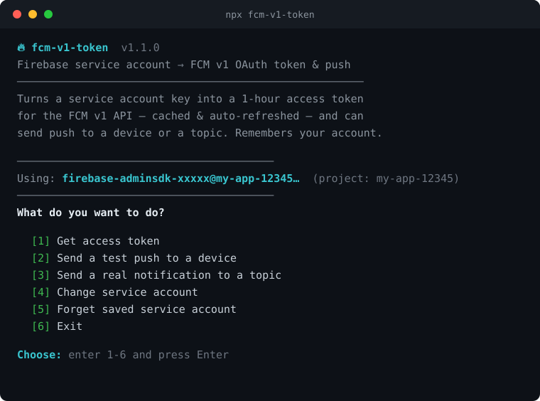
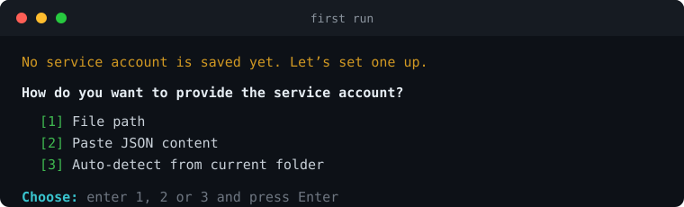
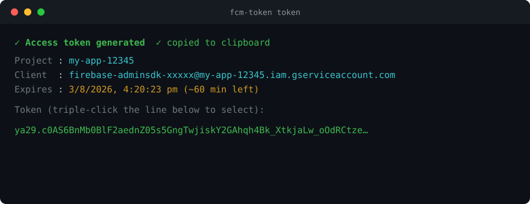

<div align="center">

# 🔥 fcm-v1-token

### Get an FCM v1 OAuth access token from a Firebase service account — and send push notifications — in seconds.

A tiny **CLI + Node.js library** that turns a Firebase **service account** key into a short‑lived **OAuth 2.0 access token** for the **Firebase Cloud Messaging (FCM) HTTP v1 API**. The token is **cached for ~1 hour and auto‑refreshed**, so you can send push notifications repeatedly without ever generating it by hand.

[](https://www.npmjs.com/package/fcm-v1-token)
[](https://www.npmjs.com/package/fcm-v1-token)
[](https://nodejs.org)
[](./LICENSE)

</div>

```bash
npx fcm-v1-token
```

<div align="center">
  
</div>

---

## Why fcm-v1-token?

The legacy FCM server key is **deprecated**. The modern **FCM HTTP v1 API** requires a short‑lived **OAuth 2.0 Bearer token** generated from a **service account**, and that token **expires after 1 hour**. Generating it by hand (sign a JWT, exchange it at `oauth2.googleapis.com/token`, remember to refresh) is fiddly.

**fcm-v1-token does it for you** — from the terminal or from code:

- 🔑 **Any input** — a service account **file path**, **pasted JSON**, or a credentials **object**
- 🧠 **Remembers** your service account between runs — set it once, never paste it again
- 🖥️ **Interactive CLI** — run it and pick what to do (get token / send push)
- 🔁 **Caches the token ~1 hour and auto‑refreshes** it before expiry
- 📋 **Copies the token to your clipboard** automatically (and prints it copy‑friendly)
- 📤 **Sends push** via the FCM v1 API with a one‑line helper
- 📣 **Sends to a topic**: a notification (title, body, image), notification + custom data, data‑only, or your own custom JSON, delivered to every device subscribed to that topic on Android, iOS and web
- 👀 **Previews the exact FCM JSON** before sending, with a **dry‑run** option that validates without delivering
- 📦 **Zero config**, one dependency (`google-auth-library`), works with `npx`

## Table of contents

- [Install](#install)
- [Quick start (CLI)](#quick-start-cli)
- [Send a notification to a topic](#send-a-notification-to-a-topic)
- [CLI commands](#cli-commands)
- [Use as a library](#use-as-a-library)
- [How it works](#how-it-works)
- [API reference](#api-reference)
- [Where is my account stored?](#where-is-my-account-stored)
- [Security](#-security)
- [FAQ](#faq)
- [License](#license)

---

## Install

Run instantly, no install:

```bash
npx fcm-v1-token
```

Or install globally to get the `fcm-v1-token` / `fcm-token` / `fcmt` commands:

```bash
npm install -g fcm-v1-token
```

Or add it to a project as a library:

```bash
npm install fcm-v1-token
```

---

## Quick start (CLI)

Just run it. The first time, it asks for your service account (file path, pasted JSON, or auto‑detect). After that it **remembers** it.

<div align="center">
  
</div>

Pick **Get access token** and you get a color‑coded token that's **already on your clipboard**:

<div align="center">
  
</div>

Prefer scripting? Print just the token:

```bash
# Print the raw token using your saved account
fcm-token token --raw

# Capture it into a shell variable
TOKEN=$(fcm-token token --raw)

# Use it directly against the FCM v1 API
curl -X POST \
  -H "Authorization: Bearer $(fcm-token token --raw)" \
  -H "Content-Type: application/json" \
  -d '{"message":{"token":"<device-token>","notification":{"title":"Hi","body":"Hello"}}}' \
  "https://fcm.googleapis.com/v1/projects/<your-project-id>/messages:send"
```

---

## Send a notification to a topic

Pick **[3] Send a real notification to a topic** in the menu (or run `fcm-token topic`). Enter the topic, then choose what to send:

| Type | What the device gets |
| --- | --- |
| **Notification** | Title, body and an optional image, shown in the system tray |
| **Notification + data** | The same, plus your own `key=value` data for the app |
| **Data only** | A silent message that only your app's code receives |
| **Custom JSON** | Any FCM v1 message you paste. The topic you entered replaces any target in it |

You can also set the sound, the Android channel, the click action and the priority. Before anything is sent you see the exact FCM JSON and choose **Y** to send, **d** for a dry run that only validates it, or **n** to cancel.

```text
Topic : news

What do you want to send?
  [1] Notification         title, body, image — shows in the tray
  [2] Notification + data  the same, plus your own key/value data
  [3] Data only            silent — your app code handles it
  [4] Custom JSON          paste a full FCM v1 message

Title : Big Sale
Body  : 50% off today
Image : https://example.com/sale.png
  › screen=offers
  › id=42

  ⚠ This goes to EVERY device subscribed to topic "news".
Send now? Y = send · d = dry run (validate only) · n = cancel
```

Or send it in one line, without any prompts:

```bash
# Notification with an image and custom data
fcm-token send --topic news --title "Big Sale" --body "50% off today" \
  --image https://example.com/sale.png --data screen=offers --data id=42

# Data-only (silent) message
fcm-token send --topic news --data-only --data type=sync --data count=3

# Your own FCM v1 message (JSON or a .json file)
fcm-token send --topic news --message ./message.json

# Validate with FCM without delivering anything
fcm-token send --topic news --title "Test" --dry-run
```

The same message works on **Android, iOS and web**. The image is set for Android and web (`notification.image`) and for iOS (`apns.fcm_options.image` with `mutable-content`). Data-only messages go out at high priority on Android and as background pushes on iOS.

> A topic message reaches **every** device subscribed to that topic in the project of your service account. FCM does not say how many devices that is. Use `--dry-run` while you are trying things out.

---

## CLI commands

```text
fcm-token                     Interactive menu (remembers your last account)
fcm-token token [source]      Print an access token
fcm-token send  [source]      Send a push to a device (interactive prompts)
fcm-token topic [source]      Send a notification to a topic (interactive)
fcm-token use   <source>      Set / replace the saved service account
fcm-token whoami              Show the saved service account
fcm-token forget              Remove the saved service account
fcm-token --help              Show help
```

`[source]` is **optional** — if omitted, the saved account is used. It can be a **file path** (`./service-account.json`) or **JSON content** (`'{"type":"service_account",...}'`).

**Options for `token`:**

| Flag | Description |
| --- | --- |
| `--raw` | Print only the token — no color, no clipboard (for scripting) |
| `--json` | Print full info (`token`, `projectId`, `expiresAt`) as JSON |
| `--no-copy` | Do not copy the token to the clipboard |

**Options for `send` / `topic`:** with any content option (`--title`, `--body`, `--image`, `--data`, `--data-only`, `--message`) the message is sent right away without prompts. Without them you get the interactive composer.

| Flag | Description |
| --- | --- |
| `--topic <name>` | Send to every device subscribed to this topic (`/topics/` prefix optional) |
| `--device <token>` | Send to one device registration token |
| `--title <text>` | Notification title |
| `--body <text>` | Notification body |
| `--image <url>` | Image URL (Android, iOS, web) |
| `--data <key=value>` | Custom data. Repeat it, or pass a JSON object |
| `--data-only` | Silent data message (no title/body/image) |
| `--message <json\|file>` | A full custom FCM v1 message |
| `--sound <name\|none>` | Notification sound (default `default`) |
| `--channel <id>` | Android notification channel id |
| `--click-action <name>` | Android `click_action` / iOS `category` |
| `--priority <high\|normal>` | Delivery priority (default `high`) |
| `--dry-run` | Validate with FCM only, deliver nothing |
| `--yes`, `-y` | Interactive mode: skip the confirm step |
| `--json` | Print the raw FCM response as JSON |

> Set `NO_COLOR=1` to disable colors. The short alias `fcmt` works everywhere, and `npx fcm-v1-token` runs the same tool without installing.

---

## Use as a library

### Get an access token

```js
const { getAccessToken } = require('fcm-v1-token');

const { token, projectId, expiresAt } = await getAccessToken('./service-account.json');
// Call getAccessToken() as often as you like — while valid, the same cached
// token is returned; it auto-refreshes when it expires (~1 hour).
```

### Send a push notification (FCM v1)

```js
const { sendPush } = require('fcm-v1-token');

await sendPush('./service-account.json', {
  token: '<device-registration-token>',
  notification: { title: 'Hello', body: 'World' },
  data: { orderId: '123' },
});
```

Send to a **topic**. `sendToTopic` builds a message that works on Android, iOS and web:

```js
const { sendToTopic } = require('fcm-v1-token');

// Notification with an image and custom data
await sendToTopic('./service-account.json', 'news', {
  title: 'Breaking',
  body: 'Something happened',
  image: 'https://example.com/photo.png',
  data: { articleId: 42 }, // values are sent as strings
});

// Data-only (silent) message
await sendToTopic('./service-account.json', 'news', {
  dataOnly: true,
  data: { type: 'sync' },
});
```

Or build the message yourself and pass it to `sendPush`:

```js
const { buildMessage, sendPush } = require('fcm-v1-token');

const message = buildMessage({
  topic: 'news', // or token: '<device-token>', or condition: "'a' in topics"
  title: 'Hello',
  body: 'World',
  channelId: 'promo',
  clickAction: 'FLUTTER_NOTIFICATION_CLICK',
});
await sendPush('./service-account.json', message);
```

**Validate only** (do not deliver):

```js
await sendPush(serviceAccount, message, { dryRun: true });
```

### Pass content or an object instead of a file path

```js
// From an environment variable (recommended for servers)
const sa = JSON.parse(process.env.FIREBASE_SERVICE_ACCOUNT);
await getAccessToken(sa);

// Or a pasted JSON string
await getAccessToken('{"type":"service_account", ...}');
```

---

## How it works

1. Reads your service account's `client_email` and `private_key`.
2. Signs a **JWT** and exchanges it at `https://oauth2.googleapis.com/token` for an OAuth 2.0 access token, scoped to `https://www.googleapis.com/auth/firebase.messaging`.
3. **Caches** the token in memory and **auto‑refreshes** it before the ~1‑hour expiry (powered by `google-auth-library`).
4. Uses the token as a `Bearer` credential against `https://fcm.googleapis.com/v1/projects/<project-id>/messages:send`.

No secrets ever leave your machine — the token is created and used locally.

---

## API reference

| Function | Returns |
| --- | --- |
| `getAccessToken(source)` | `{ token, projectId, clientEmail, expiresAt }` |
| `sendPush(source, message, options?)` | FCM v1 response object |
| `sendToTopic(source, topic, content, options?)` | FCM v1 response object |
| `buildMessage(options)` | FCM v1 `message` object for Android, iOS and web |
| `normalizeTopic(topic)` | bare topic name (strips `/topics/`, validates) |
| `normalizeData(data)` | FCM `data` map (string values, reserved keys rejected) |
| `loadServiceAccount(source)` | validated service account object |
| `saveLastAccount(sa, source)` | persist an account for later runs → config path |
| `loadLastAccount()` | saved config, or `null` |
| `savedSource(saved)` | a usable `source` from a saved config |
| `forgetLastAccount()` | remove the saved account → `boolean` |
| `clearCache()` | clear the in‑memory token cache |

- **`source`** — a file path (string), pasted JSON content (string), or a credentials object.
- **`options`** — `{ projectId?, dryRun? }`.
- **`content`** — `{ title?, body?, image?, data?, dataOnly?, sound?, channelId?, clickAction?, priority? }`. `buildMessage` takes the same fields plus one target: `token`, `topic` or `condition`.

TypeScript types are bundled (`src/index.d.ts`).

---

## Where is my account stored?

`~/.fcm-v1-token/config.json` (permissions `0600`).

- If you passed a **file path**, only the **absolute path** is stored — your key stays in the file.
- If you **pasted** JSON content, that content is stored in the config file (there is no file to re‑read).

Run `fcm-token forget` to remove it.

---

## 🔒 Security

A service account **private key grants access to your entire Firebase project**. Treat it like a password:

- **Never commit it to git** — add `service-account*.json` to `.gitignore`.
- **Never paste it into a chat, issue, or screenshot.** If a key is ever exposed, **rotate it immediately** in the [Google Cloud Console → Service Accounts](https://console.cloud.google.com/iam-admin/serviceaccounts) (delete the leaked key, create a new one).
- On servers, prefer an **environment variable** or a secret manager over a file on disk.

---

## FAQ

**How do I get an FCM v1 API access token?**
Run `npx fcm-v1-token`, choose your service account once, and pick *Get access token* — or in code, `await getAccessToken('./service-account.json')`. The token is a standard Google OAuth 2.0 Bearer token valid for ~1 hour.

**How long does an FCM v1 access token last?**
About **1 hour** (3600 seconds). This tool caches it and refreshes it automatically, so you never hit an expired‑token error while sending push.

**How do I send an FCM v1 push notification in Node.js?**
Use `sendPush(source, message)` — see [Send a push notification](#send-a-push-notification-fcm-v1). It posts to `messages:send` with the right `Authorization: Bearer` header for you.

**How do devices subscribe to a topic?**
In the app, with the Firebase SDK:
Android `Firebase.messaging.subscribeToTopic("news")` · iOS `Messaging.messaging().subscribe(toTopic: "news")` · Flutter `FirebaseMessaging.instance.subscribeToTopic('news')` · React Native `messaging().subscribeToTopic('news')`. A new subscription can take a little while before topic messages start arriving.

**The image shows on Android but not on iOS. Why?**
iOS needs a Notification Service Extension in the app to download and attach the image. This tool already sends `mutable-content` and `fcm_options.image` for you.

**Do I still need the legacy FCM server key?**
No. The legacy server key is deprecated. The HTTP v1 API uses OAuth 2.0 tokens from a service account, which is exactly what this tool produces.

**Where do I get the service account JSON?**
Firebase Console → *Project settings* → *Service accounts* → *Generate new private key*. That downloaded JSON is your `source`.

**Does it work without installing?**
Yes — `npx fcm-v1-token` runs it directly. Install globally only if you want the short `fcmt` command always available.

**Which platforms are supported for clipboard copy?**
macOS (`pbcopy`), Windows (`clip`), and Linux (`xclip`). If none is available, the token is still printed — copy it manually.

---

## License

[MIT](./LICENSE) © [Sujeet Kumar](https://github.com/TantraIN)

---

<div align="center">
<sub>

**Keywords:** FCM v1 access token · Firebase Cloud Messaging HTTP v1 API · OAuth 2.0 bearer token · service account to access token · send FCM push notification Node.js · firebase-admin alternative · FCM token CLI

</sub>
</div>
